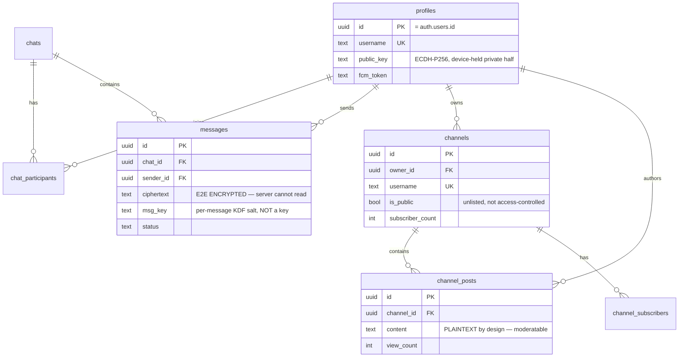

# Database ERD

Two schemas. `public` is NeverOff's own — owned by the app, and the console only ever adds to it.
`admin` is console-owned and is never exposed through PostgREST.

## Console schema (`admin`)

```mermaid
erDiagram
    permissions ||--o{ role_permissions : "granted by"
    roles ||--o{ role_permissions : bundles
    roles ||--o{ admin_users : "assigned to"
    admin_users ||--o{ sessions : "signed in on"
    admin_users ||--o{ audit_log : performed
    admin_users ||--o{ break_glass_requests : raised
    admin_users ||--o{ enforcement_actions : issued
    admin_users ||--o{ appeals : reviewed
    admin_users ||--o{ child_safety_allowlist : "authorised on"

    enforcement_actions ||--o| appeals : "appealed via"
    enforcement_actions ||--o{ notification_outbox : notifies
    enforcement_actions ||--o| user_restriction_state : projects_to
    break_glass_requests ||--o{ enforcement_actions : authorises

    profiles ||--o{ enforcement_actions : "subject of"
    profiles ||--o{ consent_records : gave
    profiles ||--o{ telemetry_events : generated
    profiles ||--o{ dsr_requests : filed
    profiles ||--o| user_restriction_state : has

    consent_definitions ||--o{ consent_records : "recorded against"
    child_safety_cases ||--o{ child_safety_access_log : "viewed via"
    child_safety_cases ||--o{ csam_hash_matches : "SCAFFOLD"
    child_safety_cases ||--o{ authority_reports : "SCAFFOLD"

    permissions {
        text key PK
        text category
        text break_glass
        bool pii
        bool super_admin_only
    }

    roles {
        text key PK
        int rank UK "strictly ordered"
        int max_ban_days "null = unlimited"
        bool is_system
    }

    admin_users {
        uuid id PK
        text email UK "unique on lower(email)"
        text role_key FK
        text status "invited|active|suspended|disabled"
        text totp_secret_encrypted "AES-256-GCM at rest"
        bigint totp_last_step "replay guard"
        text_array scope_countries "null = global"
        text_array extra_permissions
        text_array revoked_permissions
    }

    sessions {
        uuid id PK
        text token_hash UK "SHA-256; raw token only in the cookie"
        timestamptz idle_expires_at "slides"
        timestamptz absolute_expires_at "never moves"
        bool mfa_satisfied
    }

    audit_log {
        bigint id PK
        text action
        text target_type
        jsonb before_state
        jsonb after_state
        bool is_pii_access
        text prev_hash "chain"
        text entry_hash "chain"
    }

    enforcement_actions {
        uuid id PK
        uuid user_id FK
        text type "the §3.3 ladder"
        text reason_code FK
        text case_ref UK "NO-2026-000123"
        timestamptz expires_at "null = no expiry"
        timestamptz reversed_at
        text content_removal_scope
        text origin "manual|automated"
    }

    appeals {
        uuid id PK
        uuid action_id FK UK "one appeal per action"
        uuid reviewed_by FK "trigger: never the issuer"
        timestamptz sla_due_at
    }

    user_restriction_state {
        uuid user_id PK
        text status
        bool blocks_access "DIRECTORY ONLY"
        bool blocks_sending "DIRECTORY ONLY"
    }

    consent_records {
        uuid id PK
        text consent_key FK
        bool granted
        text wording_shown "verbatim"
        text country "coarse, never raw IP"
    }

    telemetry_events {
        bigint id PK
        text event_name
        jsonb properties "trigger rejects message content"
    }

    legal_holds {
        uuid id PK
        text subject_type
        text subject_id
        timestamptz released_at
    }
```

## NeverOff schema (`public`) — owned by the app

The console reads these and adds **only** functions and `RESTRICTIVE` RLS policies. No columns are
added to any of them.



## The E2EE boundary

The single most important thing this diagram encodes:

- `messages.ciphertext` is opaque to the server. `msg_key` is a random 16-byte salt fed into
  `HMAC-SHA256(ecdh_shared_secret, msg_key)` on the device. Without a private identity key —
  which never leaves the handset — there is nothing to decrypt with.
- `channel_posts.content` is plaintext, deliberately, because a channel post has no single
  recipient to derive a shared secret with.

So server-side content moderation is possible for channels and profiles, and impossible for
private messages. No amount of console tooling changes that, and none should try to.

## Integration points

| Object | Schema | Purpose |
|---|---|---|
| `neveroff_send_blocked(uuid)` | `public` | SECURITY DEFINER wrapper so RLS can consult `admin` without granting the client access to it |
| `neveroff_access_blocked(uuid)` | `public` | Same, for full account blocks |
| `neveroff_feature_restricted(uuid, text)` | `public` | Same, per feature |
| `my_enforcement_status(text)` | `public` | Everything the §4 ban screen needs, in one call |
| `submit_appeal(uuid, text, text)` | `public` | Structured appeal submission |
| `my_appeals()` | `public` | Appeal progress for the ban screen |
| `acknowledge_warning(uuid)` | `public` | §3.3 warning acknowledgement |
| 4 × `RESTRICTIVE` policies | `public` | AND-ed with the app's existing permissive policies |

`authenticated` holds `EXECUTE` on exactly those seven functions and nothing else. No `USAGE` on
the `admin` schema is granted anywhere, and a post-condition check in migration 0006 asserts it.
